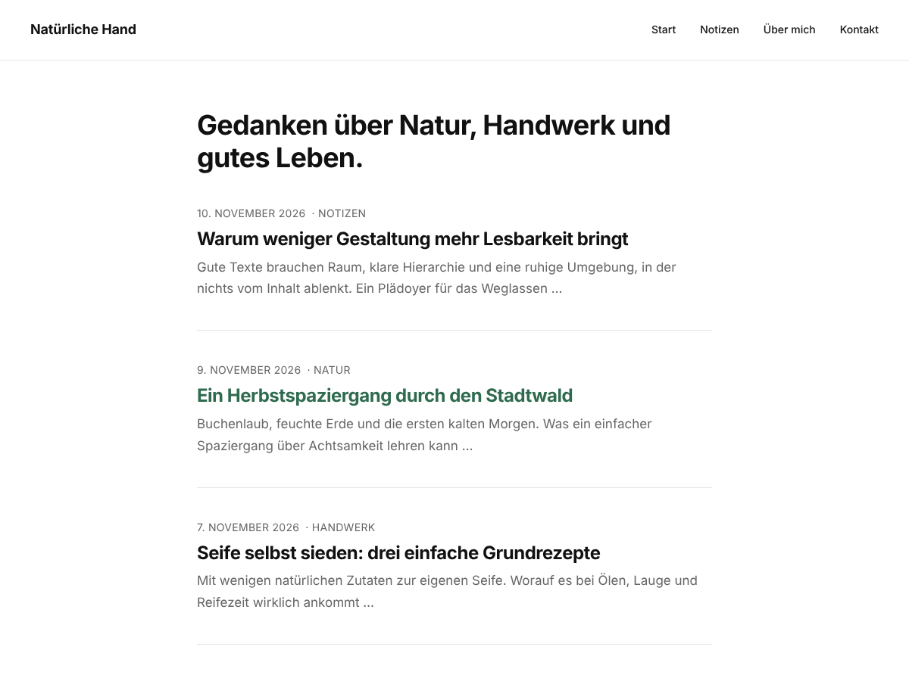

# Naturaly – WordPress Block-Theme

Minimalistisches, cleanes Block-Theme (Full Site Editing) für Blogs und Magazine.
Schwarz/Weiß mit einem grünen Akzent, einspaltig, Systemschriften (keine externen Fonts, DSGVO-freundlich).

*Designvorschau der Startseite mit Beispielinhalten, erzeugt aus den Farben, Größen und Abständen des Themes. Die echte Darstellung kann je nach Inhalten und Plugins leicht abweichen.*

## Installation

**Als ZIP (empfohlen):** [`naturaly.zip` (neueste Version)](https://github.com/moo2102/naturaly/releases/latest/download/naturaly.zip) herunterladen und in WP-Admin unter
*Design → Themes → Theme hinzufügen → Theme hochladen* installieren. Vor dem Aktivieren die *Live-Vorschau* nutzen.

**Per Git/SFTP:** Repo nach `wp-content/themes/naturaly` klonen bzw. hochladen, danach unter *Design → Themes* aktivieren.

Voraussetzung: WordPress ≥ 6.6, PHP ≥ 7.4.

## Aufbau

| Pfad | Inhalt |
|---|---|
| `theme.json` | Farben, Schriftgrößen, Abstände, Block-Stile (zentrale Design-Tokens) |
| `styles/dark.json` | Style-Variation „Dark“ (unter *Design → Editor → Stile* wählbar) |
| `templates/` | `index`, `home`, `single`, `page`, `page-no-title`, `archive`, `search`, `404` |
| `parts/` | Header (Site-Titel + Navigation), Footer |
| `patterns/` | Beitragsliste, Blog-Intro, Kommentare, Suche, 404, Footer |
| `assets/css/theme.css` | Kleine Ergänzungen, die `theme.json` nicht abbildet |

## Anpassen

- **Akzentfarbe:** in `theme.json` → `settings.color.palette` → `accent` (oder im Website-Editor unter *Stile → Farben*).
- **Inhaltsbreite:** `settings.layout.contentSize` (Standard 680px).
- **Menü:** im Website-Editor den Navigationsblock im Header bearbeiten.
- **Blog-Intro:** zeigt den Untertitel der Website (*Einstellungen → Allgemein*).

Änderungen im Website-Editor werden in der Datenbank gespeichert und überschreiben die Dateien im Theme.

## Releases

Installierbare ZIP-Dateien gibt es unter [GitHub Releases](https://github.com/moo2102/naturaly/releases).
Der Link [`releases/latest/download/naturaly.zip`](https://github.com/moo2102/naturaly/releases/latest/download/naturaly.zip) zeigt immer auf die neueste Version.

**Neue Version veröffentlichen:**

1. `Version:` in `style.css` (und `Stable tag` in `readme.txt`) erhöhen und committen.
2. Passenden Tag pushen, z. B. `git tag v1.0.1 && git push origin v1.0.1`.
3. Der Workflow `.github/workflows/release.yml` baut `naturaly.zip` und legt das Release an.
   Stimmt der Tag nicht mit der Version in `style.css` überein, bricht er ab.
